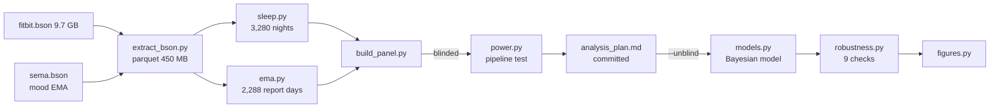
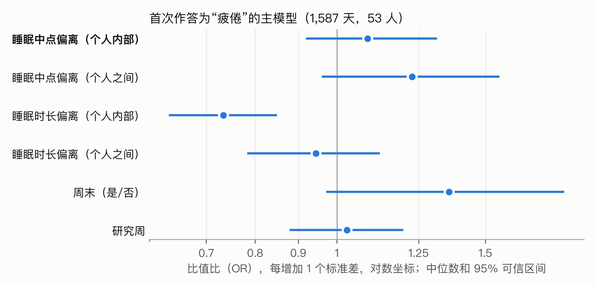
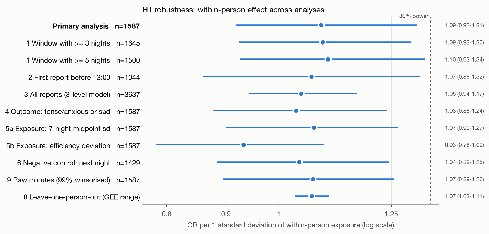

# WearableTech: the score says you slept well, so why are you tired?

> Using LifeSnaps Fitbit data and daily mood check-ins to size the gap between "sleep data looks fine" and "I feel tired", test the usual explanations one by one, and find what wearable products still miss. The analysis plan was frozen before outcomes were unblinded.

English | [中文](README_CN.md) | [Interactive page](https://arcadianlyric.github.io/WearableTech_Product/)

## Impact

- **Sized a pain point the score hides.** 35% of tired days follow ≥ 7 h of sleep; of the 40 people with at least one "good night", 15 (38%) still woke up tired after one. Duration and efficiency don't capture this part of how users feel.
- **Tested the usual explanations and retired two popular ones.**
  - "Keep a regular schedule": departing from one's usual sleep timing shows **no detectable link** to next-day tiredness (pre-registered primary hypothesis, OR 1.09, 95% CrI 0.92–1.31).
  - "Warmer nights → worse mood": the published association reproduces when pooled (OR 1.24) but is 1.00 within person. It tracks *who* (mainly sex), not *which day*.
  - What holds is **sleep duration**: 1 h less than usual raises the odds of tiredness by about 27% (OR 0.73 per sd, CrI 0.63–0.85) and passes a negative control. After a good night, the strongest lead is **the previous day's training load** (OR 1.76; next-day activity as a negative control gives 0.95).
- **Found an underserved segment.** Women report negative mood about twice as often as men (23.6% vs 13.1%), yet nightly temperature varies no more within women than within men here, so this data shows no evidence of a cycle signal, and women are under-sampled. Generic baselines and models risk learning spurious signals.
- **Turned findings into testable product hypotheses.** An explanation layer ("your sleep was fine, but yesterday's load was twice your usual"), load-aware recovery scores, cycle-aware baselines, by-sex evaluation as a release gate, and, in the other direction, graded body-signal alerts for "strained but not tired", each with an A/B or external-data validation plan. See [Product insights](#-product-insights).
- **Credible because the analysis was locked first.** The pipeline was built on outcome-blinded data and the plan committed (`4f44e67`) before unblinding. Power simulation puts 80% power at OR ≈ 1.35, so the null means "no effect larger than 1.35". Negative controls and 9 robustness checks agree.

## Background

**How the project got to "the score is fine, so why am I tired?"** It started from the most common advice in the industry, "keep a regular schedule". The pre-registered test did not support it. The better question then became: how often do users feel tired when the data looks fine, what drives it, and who is hit hardest? Results report the pre-registered analysis in full first, then the post hoc and exploratory work it led to, each labelled with its level of evidence, and [Product insights](#-product-insights) pulls them together.

Whoop and Oura sell personalised "recovery" and "readiness" guidance, and "keep a regular schedule" is a standard tip. Most of the evidence behind it compares people: regular sleepers are healthier on average, which mixes in personality, job and age. The product-relevant question is within-person: when **the same person** sleeps at a more unusual time than usual, are they worse off the next day?

Public analyses tend to blur between- and within-person effects, split days at random (leaking a person's data into both train and test), and tune the analysis after seeing outcomes. This project splits each exposure into a person mean and a within-person deviation, models person-specific slopes with random effects, and keeps outcomes blinded until the plan is frozen.

LifeSnaps (CC-BY-4.0, direct download) was chosen over GLOBEM (PhysioNet credentialed access) because its mood reports are daily, not weekly. Bayesian hierarchical models (Bambi/PyMC) are used because with 53 people a frequentist random-slope GLMM easily ends up singular, and a posterior for the slope sd is more honest than a boundary estimate of zero.

## Quick Start

```bash
conda env create -f environment.yml && conda activate wearable   # Python 3.13

# LifeSnaps v4 (615 MB, CC-BY-4.0), md5 726afe263ab4b900a721eac19b2ca13a
# https://zenodo.org/records/7229547/files/rais_anonymized.zip?download=1
unzip rais_anonymized.zip -d data/raw/

python src/extract_bson.py data/raw/rais_anonymized/mongo_rais_anonymized data/interim/bson
python src/build_panel.py                 # blinded panel
python src/power.py data/interim/panel_blind.parquet reports/power.csv
python src/build_panel.py --unblind       # only after analysis_plan.md is committed
python src/models.py data/interim/panel.parquet reports/main
python src/robustness.py data/interim/panel.parquet reports/robustness.csv
python src/figures.py

# post hoc and exploratory
python src/posthoc_temperature.py data/interim/panel.parquet reports/posthoc_temperature.csv
python src/posthoc_good_nights.py data/interim/panel.parquet reports/posthoc_good_nights
python src/posthoc_early_waking.py reports/posthoc_early_waking

# Aggregated data for the interactive page (docs/data.json); fails if defaults drift from reports/
python src/export_viz_data.py data/interim/panel.parquet docs/data.json
```

## Project structure

```
Wearable_Tech/
├── analysis_plan.md        # frozen before unblinding
├── environment.yml
├── src/
│   ├── extract_bson.py     # BSON -> one parquet per data type
│   ├── sleep.py            # main-sleep cleaning, midpoint, deviations
│   ├── ema.py              # mood EMA cleaning, first report of the day
│   ├── build_panel.py      # analysis panel with blinding switch
│   ├── power.py            # power simulation on the real structure
│   ├── models.py           # Bayesian primary model + GEE cross-check
│   ├── robustness.py       # checks 1–9
│   ├── posthoc_temperature.py   # post hoc: nightly temperature (spec: analysis_addendum_temperature.md)
│   ├── posthoc_good_nights.py   # exploratory: tired after good nights (not pre-specified)
│   ├── posthoc_early_waking.py  # exploratory: previous-day stress and early waking (not pre-specified)
│   ├── export_viz_data.py       # aggregated data for the interactive page
│   └── figures.py
├── reports/                # blind/, main/, robustness.csv, figures/
└── data/                   # gitignored
```



## Materials and Methods

**Inputs.** Fitbit `sleep` records (start, end, minutes asleep, efficiency, main-sleep flag) from `fitbit.bson`; the Context and Mood Survey from `sema.bson` (one of 7 moods, up to 3 times a day); coarse demographics and steps from the daily CSV. The daily CSV has no bed/wake times, so the BSON is parsed with `bson.decode_file_iter` from `pymongo`, streaming 9.7 GB of BSON into 450 MB of parquet with no MongoDB install. The headline "71 people × 4 months" shrinks to 1,587 days from 53 people with both last night's sleep and a mood report.

**Cleaning.** 4,141 sleep records → 3,415 main sleeps after `logId` dedup → 3,280 nights (longest per person-night, 3–14 h asleep, midpoint no later than noon on the wake date). 5,027 valid mood reports from 63 people. Joined to last night with ≥ 4 nights in the 7-night window: **1,587 days, 53 people**.

**Variables.** Outcome: the day's first report is TIRED. Primary exposure: `log(1 + |last night's midpoint − mean midpoint of the other nights in the window|)` in minutes (raw values are right-skewed: median 34, max 544). Adjusted for signed duration deviation, weekend and study week. Each exposure is split into person mean (`_b`) and within-person deviation (`_w`), each scaled to sd 1.

**Model.**

```
tired ~ mid_dev_w + mid_dev_b + dur_dev_w + dur_dev_b + weekend + study_week_z
        + (1 + mid_dev_w | uid)            Bernoulli, logit
```

Bambi 0.21 / PyMC 6.3, default weakly informative priors, 4 chains × 1,000 draws, `target_accept=0.95`; all R-hat ≤ 1.003, bulk ESS ≥ 1,354. GEE logistic (exchangeable) as a cross-check.

**Blinding.** Outcomes are permuted within person (seed 20261029). The blinded run gave OR 1.00 (0.85–1.18) for the focal term, as it should. Between-person effects survive permutation and were seen before freezing (`analysis_plan.md` §7).

**Power.** Real people, days and exposures; simulated outcomes (intercept sd 1.0, slope sd 0.3); 200 runs per OR. Power: 0.15 / 0.48 / 0.73 / 0.99 at OR 1.1 / 1.2 / 1.3 / 1.5.

## Results



| Term | OR (median) | 95% CrI |
|---|---|---|
| **Midpoint deviation, within (H1)** | **1.09** | **0.92–1.31** |
| Midpoint deviation, between | 1.23 | 0.96–1.56 |
| Duration deviation, within | 0.73 | 0.63–0.85 |
| Duration deviation, between | 0.94 | 0.78–1.12 |
| Weekend | 1.35 | 0.97–1.86 |
| Random-slope sd (logit) | 0.20 | 0.01–0.47 |

**H1 not supported.** P(β > 0) = 0.83: leaning positive, but below the detectable size. **H2 undetermined**: the slope-sd posterior runs from 0.01 to 0.47 (person-level ORs roughly 0.76–1.56). **H3**: the next night's deviation gives OR 1.04, about the same as the primary estimate, so whatever small signal exists is not specific to last night.



All 9 checks give ORs between 0.93 and 1.10 with intervals spanning 1; FDR-adjusted GEE p ≥ 0.71. Being tired yesterday predicts neither a missing report today (OR 0.85, 0.65–1.12) nor a missing sleep record tonight (OR 1.07, 0.85–1.34). Leave-one-person-out GEE ORs span 1.03–1.10.

**Unplanned finding: duration.** Duration deviation was an adjustment term, not a hypothesis. A **post hoc** negative control on the same sample gives OR 0.71 (0.60–0.85) for last night versus 1.06 (0.94–1.20) for the following night (`reports/posthoc_duration_negctrl.csv`). One within-person sd is about 1.3 h, so each hour short of one's usual sleep multiplies the odds of "tired" by about 1.27.

**Post hoc: nightly skin temperature.** Prior work on this dataset reports higher nightly temperature as the strongest predictor of sad/tense days, without separating between- and within-person variation (`memory/previous_analysis.md`). The addendum spec (`analysis_addendum_temperature.md`) was written before running. 1,551 days, 51 people.

| Outcome | Pooled, undecomposed (as in prior work) | Within-person | Between-person (sex-adjusted) | Female |
|---|---|---|---|---|
| Tense/anxious or sad | **1.24** (1.08–1.43), p = 0.002 | 1.00 (0.81–1.20) | 1.09 (0.76–1.57) | **2.50** (1.14–5.57) |
| Happy | **0.85** (0.73–0.97), p = 0.02 | 1.00 (0.85–1.21) | 0.82 (0.58–1.22) | 1.87 (0.83–4.39) |
| Tired | 0.90 (0.79–1.04) | 1.06 (0.87–1.31) | 0.79 (0.59–1.05) | 1.09 (0.56–2.09) |

The pooled model **reproduces** the published association. But a person is no more likely to report negative mood on nights warmer than their own average (OR 1.00), and the between-person temperature term mostly disappears once sex is in the model: women run 0.38 °C warmer and report negative mood more often (OR 2.50). The "temperature predicts mood" signal is about *who*, mainly sex, not *which day*. Within-person ORs by sex are also near 1 (men 1.12, women 0.88).

**Exploratory: why tired after a night that looks good?** A common complaint from wearable users: high sleep score, enough duration and deep sleep, still tired. This analysis was **not pre-specified**; it was run first and then packaged as `src/posthoc_good_nights.py`, so every estimate is hypothesis-generating. "Good night" = ≥ 7 h asleep and efficiency ≥ median: 384 nights from 40 people, with a 9.6% rate of "tired" as the first report (14.7% overall).

One-at-a-time screen of 10 within-person deviations on good nights (`reports/posthoc_good_nights/screen.csv`):

| Relative to one's own usual | OR per 1 sd | p |
|---|---|---|
| More vigorous activity the previous day (1 sd ≈ 31 min) | **1.65** (1.24–2.20) | 0.001 |
| Deep-sleep ratio vs own 30-day average | **0.72** (0.59–0.89) | 0.002 |
| Midpoint shift, wake time | 0.76, 0.80 | ≥ 0.20 |
| Resting HR, NREM HR, HRV | 0.89, 1.05, 0.94 | ≥ 0.47 |
| 3-night sleep debt, last night vs usual | 0.93, 0.94 | ≥ 0.71 |

Joint model, checked on all nights (`adjusted.csv`):

- **Previous-day vigorous activity holds up**: OR 1.76 (1.24–2.50) on good nights and 1.22 (1.04–1.44) on all nights. Negative control (activity on the *next* day): 0.95 (0.83–1.08). A sleep score measures sleep, not recovery from training load.
- **Deep-sleep ratio does not**: 0.78 (p = 0.04) on good nights only, 0.96 (0.81–1.13) on all nights.
- Duration deviation weakens on good nights (0.80, 0.52–1.22), as expected when everyone already slept enough.

**Temperature and tiredness by sex (`temperature_by_sex.csv`)**: within-person temperature OR is 0.93 (0.71–1.21) for 20 women and 1.17 (0.85–1.61) for 31 men. This **cannot rule out a menstrual-cycle effect**: within-person temperature variability is the same in women and men (median sd 0.43 vs 0.42 °C), so this data shows no sign of the cycle's warming, though comparing variability cannot prove the sensor misses it, and the dataset has no cycle labels.

## Product insights

The analyses above are also a way to find user needs. Each item reads: pain point → evidence → product opportunity → how to validate. Evidence strength is tagged: **pre-registered** (frozen before unblinding), **post hoc** (written spec), **exploratory** (not pre-specified; hypothesis only).

### 1. "Numbers look fine, still tired" is real and sizeable (exploratory)

- **Size**: 35% of tired days follow ≥ 7 h of sleep; 16% follow nights that are both long and efficient; 15 of 40 people hit it at least once.
- **Lead**: on those good nights the most robust predictor is **previous-day vigorous activity** (OR 1.76, negative control 0.95), not deep sleep, HRV or timing.
- **Opportunity**:
  - **Explanation layer**: when the score is high but the user feels tired, say why ("yesterday's training load was 40% above your usual") instead of leaving them to doubt the device.
  - **Recovery scores that weigh training load**, not sleep alone.
  - **One-tap check-in** to capture score–feeling mismatches, the most valuable personalisation data there is.
- **Validate**: north-star metric "score–feeling agreement rate"; A/B test a load-aware explanation card on check-in rate, trust in the score and 4-week retention.

### 2. Compare to the user's own usual, not to absolute thresholds (pre-registered + post hoc)

- **Evidence**: 1 sd less sleep than one's usual gives OR 0.73 for tiredness and passes a negative control; a "7 hours" threshold misses the 35% above.
- **Opportunity**: phrase every insight relative to the personal baseline; design the 1–2-week cold start before a baseline exists.

### 3. Don't promise next-day benefits from a regular schedule (pre-registered)

- **Evidence**: timing deviation shows no detectable link to next-day tiredness (OR 1.09, 0.92–1.31, consistent over 9 checks).
- **Opportunity**: if "keep a regular schedule" nudges stay, frame them as long-term; run an experiment before building more of them.

### 4. Women need cycle-aware baselines and separate model evaluation (post hoc + exploratory)

- **Evidence**:
  - Women report negative mood almost twice as often (23.6% vs 13.1%; OR 2.50 in the model).
  - The published "warmer nights → worse mood" link is mostly **sex**, not day-to-day change (within-person OR 1.00). Pooled models learn this spurious signal.
  - This data shows **no evidence of a cycle signal**: within-person temperature variability is the same in women and men (0.43 vs 0.42 °C). That compares spread only and cannot prove the sensor misses the cycle; the mcPHASES paper reports skin temperature varying by cycle phase.
  - Women are 20 people and 38% of days: under-represented to begin with.
- **Opportunity**:
  - **Phase-aware personal baselines**, so the normal luteal rise in temperature and HR is not flagged as illness or poor recovery.
  - **Cycle and symptom logging**: the literature finds symptom burden explains sleep and recovery better than phase.
  - **Evaluate models by sex** and make subgroup metrics a release gate.
- **Validate**: on mcPHASES (hormone-defined phases), measure how many false alerts a phase-aware baseline removes; or directly on a user's n-of-1 data.

### 5. Ship personal baselines before complex models (pre-registered + literature)

- **Evidence**: between-person differences dwarf day-to-day ones (intercept sd 0.72); a third of people with good nights never report tiredness after them. In prior work, a per-person mean beat every deep model under person-level splits.
- **Opportunity**: launch personal baselines and segments first; any complex model must beat the per-person mean to ship.

### 6. Subjective labels are scarce; check-ins must cost almost nothing (dataset report)

- **Evidence**: EMA compliance was 43% and fell about 18% over the study.
- **Opportunity**: make item 1's check-in close to free (lock-screen widget, one tap), or ask only when score and behaviour disagree.

### 7. The reverse gap: the body is strained, but the user doesn't feel tired (exploratory)

Item 1 is "data fine, still tired". This is the opposite: physiology departs from the person's baseline and they don't notice. A common explanation is that cortisol and adrenaline under acute stress mask fatigue. This dataset has no hormone measures, so **the mechanism can't be tested here and stays a hypothesis**.

- **Evidence** (`reports/posthoc_good_nights/masked_strain.csv`; 37 people, 1,086 days with HR and HRV):
  - A "strain day" is resting or NREM heart rate ≥ 1 sd above one's own mean, or RMSSD ≥ 1 sd below it. These are 29% of days, and on 78% of them the person did not report tiredness.
  - "Strong strain" (≥ 2 of the 3 signals) covers 12% of days. Their tired rate is 32% vs 14% otherwise, so **68% still don't feel tired**. Those days lean toward "happy" or "alert" (40% vs 28%), consistent with an aroused state, but also with ordinary causes such as exercise, alcohol or caffeine.
  - **Strained-but-not-tired does not predict tiredness over the next 3 days**: OR 1.03 (0.67–1.59). The feature can't be sold as "you'll crash later"; its value has to be shown on outcomes other than tiredness.
  - **What an alert rule costs** ([interactive simulator](https://arcadianlyric.github.io/WearableTech_Product/)): using only the previous 14 days as a baseline, which is all a shipped product would have, the default rule (2 signals, 2 days in a row, 1 sd) fires 1.0 times per person per month (0.8–1.2). On flagged days 26% report tiredness (10%–40%) against a 16% base rate, so the ranges overlap, and it covers 6.9% of tired days. The default was fixed first; the other 26 rules are sensitivity checks.
  - Physiology: under chronic sleep restriction, subjective sleepiness levels off while cognitive performance keeps declining (Van Dongen et al., *Sleep* 2003). Feeling fine is not the same as being recovered.
- **Opportunity**:
  - **Body-signal alerts, separate from how the user feels**: "your body is under strain, even if you feel fine". Single-signal deviations are too common (29% of days) to alert on daily without alert fatigue. Require **several signals at once, sustained for 2–3+ days**.
  - **Attribute before alerting**: strain explained by training load, alcohol, a late meal or the luteal phase gets a "go lighter today". **Unexplained, multi-day strain** is the signal worth surfacing.
  - **A graded escalation path**: a sustained resting-HR rise together with higher temperature and respiratory rate can precede infection symptoms (Mishra et al., *Nature Biomedical Engineering* 2020; Radin et al., *Lancet Digital Health* 2020), which supports "you may be getting sick, rest up". Only signals such as irregular rhythm or low SpO2 justify "see a doctor", and those go through the medical-device regulatory route. Never diagnose, and word alerts to avoid anxiety.
- **Validation**: use outcomes beyond tiredness (sick days, infections, injuries; PMData logs injuries); measure alert precision and false-alarm rate; A/B test whether users change their plans and whether alerts raise anxiety or churn.

## Discussion

**For the product.** In this sample, sleeping *less than you usually do* explains next-day tiredness better than sleeping *at a different time than usual*. Duration deviation is the better-supported next-day signal. The exploratory analysis adds that "high sleep score, still tired" may be better explained by the previous day's training load, which argues for recovery scores that weigh training load rather than sleep alone. Timing regularity may matter over longer horizons or for a subgroup; this sample cannot tell.

**Attributing early waking: stress and cortisol, or something else?** A common complaint is waking very early under stress and not being able to fall back asleep. A wearable records "woke earlier than usual" but cannot measure cortisol or tell causes apart.

- **Physiology.** Cortisol follows a daily rhythm: lowest soon after sleep onset, rising through the second half of the night, and peaking 30–45 min after waking (the cortisol awakening response, CAR). Because the late night is when cortisol climbs, an overactive HPA (hypothalamic–pituitary–adrenal) axis under stress plausibly shows up as early waking and trouble getting back to sleep. Evidence:
  - People with chronic insomnia have higher evening and nocturnal cortisol and ACTH (Vgontzas et al., *J Clin Endocrinol Metab* 2001).
  - Merely expecting to wake early raises ACTH before waking (Born et al., *Nature* 1999), so the axis prepares for waking ahead of time.
  - Early-morning awakening is also a classic symptom of depression.
- **The watch does not measure cortisol.** Heart rate, HRV and skin conductance (EDA) track the sympathetic–adrenomedullary system, which acts within minutes. Cortisol belongs to the HPA axis and acts over tens of minutes to hours. The two often move together but are not interchangeable; reading "low HRV" as "high cortisol" is a mistake.
- **Data signatures of different causes** (a first-pass attribution without hormones):

| Possible cause | Signature in wearable data | Extra log needed |
|---|---|---|
| Stress and hyperarousal | Normal sleep onset, **final awakening earlier**, long wake after it; higher HR and lower HRV in the 1–2 h before waking | Previous-day stress rating, work events |
| Circadian phase advance | **The whole sleep window shifts earlier** (onset too), duration roughly unchanged, persisting several days | Evening light, schedule |
| Alcohol rebound | High HR and low HRV early in the night, fragmented second half | Drinks |
| Nocturia | Brief awakenings **with steps** | Fluid timing |
| Environment | Waking coincides with sunrise; more common in summer | Room temperature, light, noise |
| Luteal phase | Higher nightly skin temperature, more awakenings | Cycle day |

- **Data that would link wearable signals to cortisol more tightly:**
  - **Salivary cortisol** at waking, +30 and +45 min, plus one bedtime sample. This is the standard CAR protocol and can be done with home kits. Sampling time must be exact: a few minutes' delay understates the CAR.
  - **Hair cortisol**: each cm of hair holds roughly a month of cumulative exposure. It suits weeks-to-months stress and sleep trends, not single nights.
  - **Urine hormone panels** (e.g. dried urine tests): a full-day cortisol curve, at higher cost.
  - **Sweat cortisol sensors**: research prototypes, not yet consumer products; worth watching.
  - **Public data**: MMASH (22 healthy young men) has salivary cortisol and melatonin together with RR intervals, actigraphy and sleep, enough to test whether nocturnal HR and HRV predict morning cortisol. It is male-only and covers just 24 h.
- **A feasible n-of-1 design.** Over 2–4 weeks, collect salivary cortisol as above on both high-stress and ordinary days. Log stress, alcohol, caffeine and cycle day. From the watch, take the final wake time, wake minutes in the last 2 h of sleep, and HR and HRV before waking. Then use this project's within-person models to test "previous-day stress → early waking" and "early waking → CAR".
- **A first test on LifeSnaps** (exploratory; `src/posthoc_early_waking.py` → `reports/posthoc_early_waking/early_waking.csv`; 3,280 nights, 64 people):
  - "Early waking" = final wake ≥ 60 min earlier than one's usual (median, computed separately for weekday and weekend wake-ups). **Normal onset, early wake** covers 9.3% of nights, a median of 89 min early; **the whole night shifted earlier** covers 3.5%.
  - **Reporting "tense/anxious" the day before raises the odds of early waking**: OR 1.41 (0.92–2.17). The direction fits "stress → early waking", but the interval crosses 1, so no conclusion. The contrasts don't show it: previous-day tension vs a whole-night shift gives 0.76, and tension the day *after* (negative control) gives 0.91.
  - **Fitbit's own stress score doesn't predict early waking at all**: OR 0.98, and 0.99 for its HRV/EDA "responsiveness" component. For this question, one subjective check-in carries more information than the device's stress score.
  - **Weak signs of arousal in physiology.** On early-waking nights, NREM heart rate is above one's usual (OR 1.18 per sd, 1.02–1.36), while RMSSD doesn't differ (0.98). HR in the hour before waking is 2.2 bpm higher (0.9–3.6) than in **the same clock window on the person's nights still asleep then**, in 61% of people. But HR rises before any waking, so this can't separate stress arousal from the normal waking transition. Comparing the pre-wake hour against the whole night instead is confounded by clock time, since an early wake sits nearer the circadian HR low.
  - **"Couldn't fall back asleep" is invisible.** The Fitbit log ends at the final awakening; the closing wake bout has a median of 0 min. Time lying awake after an early wake is simply not recorded.
- **For the product.** If early waking can be attributed to stress, "woke early and stayed awake" becomes a stress-overload signal. It belongs next to the body-signal alerts in insight 7, with targeted advice (CBT-I-style relaxation, not checking the clock at night) instead of a generic "go to bed earlier". The test above also points to two product gaps: the device can't see "awake and couldn't get back to sleep", which a one-tap morning check-in could fill ("did you lie awake after waking?"); and the device's stress score is useless here, while a subjective stress check-in carries signal.

**Limits.** 53 people with a median of 29 days each, minimum detectable OR ≈ 1.35. Single-choice mood is a coarse measure. Only 66% of first reports come before 13:00. Fitbit sleep timing is not PSG-validated, and participants are self-selected European adults. The data are observational: the duration link could reflect a shared cause (e.g. yesterday's workload), and a negative control only rules out part of that.

**To-do.**
- [ ] Replicate on PMData (16 people, daily 1–5 fatigue/readiness) with a cumulative-logit mixed model; write the addendum plan first.
- [ ] Test duration deviation as a **pre-specified** hypothesis on PMData, since here it is post hoc.
- [ ] Test "previous-day training load → next-day fatigue" as a pre-specified hypothesis on PMData (daily fatigue plus training logs).
- [ ] n-of-1 extension: parse an Apple Health export, add a daily tiredness and cycle-day log, and reuse the within-person model to test cycle phase and symptoms directly.
- [ ] Physiological outcomes: RMSSD and nightly resting HR relative to personal baseline.
- [x] First LifeSnaps test of early-waking attribution (above): previous-day tension → early waking OR 1.41 (0.92–2.17), right direction, not significant.
- [ ] Next for early waking: test "previous-day stress → early waking" as a pre-specified hypothesis on PMData or n-of-1 data; add a one-tap morning check-in for "lay awake after waking"; use MMASH to test nocturnal HRV against morning salivary cortisol.
- [ ] Lightweight model comparison: personal base rate vs hand-crafted features vs a simple sequence model under leave-subject-out CV, testing whether a complex model beats the personal baseline (~8–10 h). Multimodal deep learning lives in a separate project.
- [ ] GLOBEM (497 people) to test timing regularity at the weekly scale.

## Data and citation

Yfantidou, S. *et al.* LifeSnaps, a 4-month multi-modal dataset capturing unobtrusive snapshots of our lives in the wild. *Scientific Data* 9, 663 (2022). Data: Zenodo 7229547, CC-BY-4.0. Raw data are not included in this repository.
