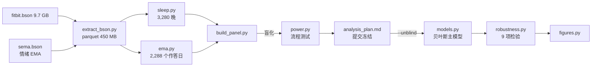
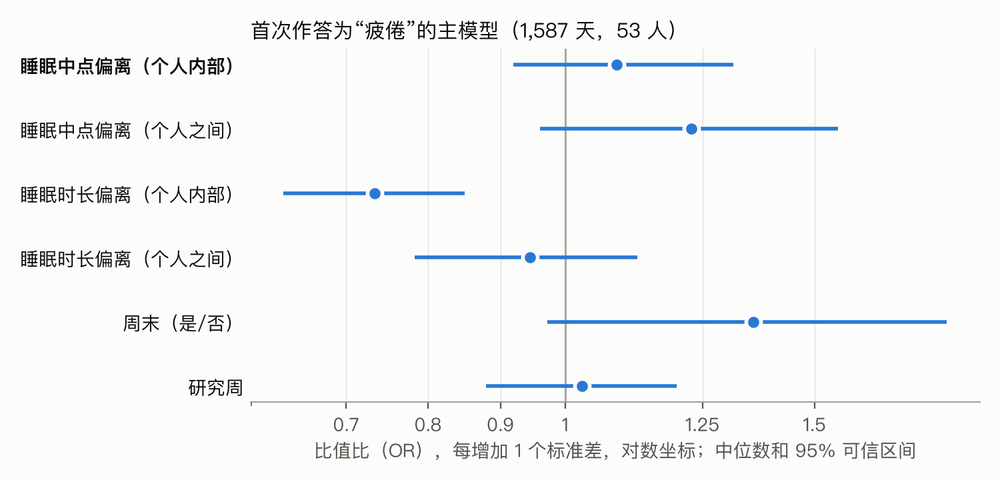
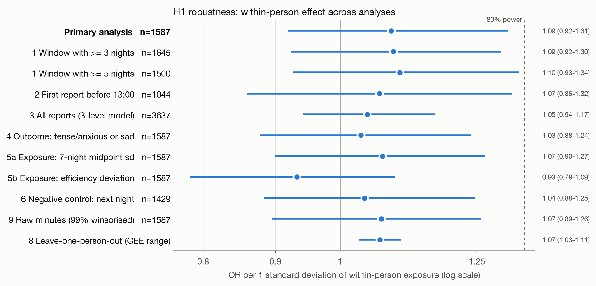

# WearableTech：分数正常，为什么还是累？

> 用 LifeSnaps 的 Fitbit 数据和每日情绪打卡，量化"睡眠数据看起来没问题，人却很累"这个落差，逐一检验常见的解释，找出可穿戴产品还没有覆盖到的需求。分析计划在看结果之前就已提交冻结。

[English](README.md) | 中文 | [交互页面](https://arcadianlyric.github.io/WearableTech_Product/)

## Impact

- **量化了一个被分数掩盖的痛点**：35% 的疲倦日，前一晚睡够了 7 小时；有过"好睡眠"记录的 40 人里，15 人（38%）遇到过"睡得好还是累"。睡眠时长、睡眠效率这类指标，覆盖不了用户的这部分感受。
- **逐一检验常见解释，淘汰了两个流行说法**：
  - "作息要规律"：作息时间偏离本人习惯，和第二天的疲倦**没有可检测的关联**（预注册主假设，OR 1.09，95% 可信区间 0.92–1.31）。
  - "夜间体温高 → 情绪差"：不分解时能复现这个已发表的关联（OR 1.24），拆成个人内部和个人之间后，个人内部效应是 1.00。它反映的是"哪些人"（主要是性别），不是"哪一天"。
  - 站得住的是**睡眠时长**：比平时少睡 1 小时，疲倦的几率约升高 27%（每 1 个标准差 OR 0.73，区间 0.63–0.85），并通过了负对照。好睡眠之后最强的线索是**前一天的训练量**（OR 1.76；用第二天的运动量做负对照，结果是 0.95）。
- **发现一个服务不足的用户群**：女性报告负面情绪的比例约是男性的 2 倍（23.6% 对 13.1%），但这份数据里，女性的夜间温度波动并不比男性大，没有看到周期信号的证据，女性样本也偏少。通用的基线和模型可能会学到虚假的信号。
- **把发现转成可以验证的产品假设**：解释层（"睡眠没问题，但昨天的训练量是平时的 2 倍"）、把训练负荷算进恢复评分、考虑周期的基线、按性别评估作为上线门槛；反过来，对"身体有负荷却不觉得累"做分级的身体信号提醒。每一条都配了 A/B 测试或外部数据的验证方案，详见 [产品洞察](#-产品洞察)。
- **结论可信，因为先锁死了分析**：先在结局盲化的数据上跑通全流程，再提交分析计划（`4f44e67`），最后才揭盲；功效模拟显示 80% 功效对应 OR ≈ 1.35，所以否定结果的含义是"没有大于 1.35 的效应"；负对照和 9 项稳健性分析的结论一致。

## Background

**这个项目怎么一步步走到"分数正常却很累"。** 一开始的预设问题是行业里最常见的一条建议："作息要规律"。预注册的检验没有支持它。这时候真正值得问的变成了：用户觉得累，可是数据看起来没问题，这种情况有多常见？是什么造成的？哪些用户受影响最大？下面的 Results 先完整报告预设分析，再报告由它引出的事后分析和探索性分析；每个结果都标注了证据等级，最后汇总成 [产品洞察](#-产品洞察)。

Whoop、Oura 这类产品的核心卖点，是基于个人数据的"恢复"和"准备度"建议。其中一条常见建议是"作息要规律"。但支撑这条建议的证据大多来自**个人之间**的比较：作息规律的人整体更健康。这种比较混杂了性格、工作、年龄等大量因素。对产品更有用的问题是**个人内部**的：**同一个人**在作息比自己平时更乱的那天，状态会不会更差？

现有的公开工作有三个常见问题：把个人之间和个人内部的效应混为一谈；按天随机划分训练集和测试集，导致信息泄露；看了结果之后再调整分析。本项目针对这三点的设计是：把每个暴露变量拆成个人均值和个人内部偏离两部分（组间和组内分解）；用随机斜率估计"每个人的敏感度差多少"；在冻结分析计划之前一直盲化结局。

数据选了 LifeSnaps（CC-BY-4.0，可以直接下载），而没有选 GLOBEM（需要 PhysioNet 凭证访问）。原因是 LifeSnaps 的情绪是**每天**作答的，粒度比 GLOBEM 的每周问卷细。模型用贝叶斯分层模型（Bambi/PyMC），因为 53 个人估随机斜率时，频率学派的模型容易出现奇异拟合；贝叶斯方法可以直接给出斜率标准差的后验分布，不会把它悄悄估成 0。

## Quick Start

```bash
# 1. 环境（Python 3.13）
conda env create -f environment.yml
conda activate wearable

# 2. 数据：LifeSnaps v4（615 MB，CC-BY-4.0），解压到 data/raw/
#    https://zenodo.org/records/7229547/files/rais_anonymized.zip?download=1
unzip rais_anonymized.zip -d data/raw/   # md5 726afe263ab4b900a721eac19b2ca13a

# 3. 完整流程
python src/extract_bson.py data/raw/rais_anonymized/mongo_rais_anonymized data/interim/bson
python src/build_panel.py                 # 盲化面板
python src/power.py data/interim/panel_blind.parquet reports/power.csv
python src/build_panel.py --unblind       # 揭盲（仅在 analysis_plan.md 提交之后）
python src/models.py data/interim/panel.parquet reports/main
python src/robustness.py data/interim/panel.parquet reports/robustness.csv
python src/figures.py

# 事后分析和探索性分析
python src/posthoc_temperature.py data/interim/panel.parquet reports/posthoc_temperature.csv
python src/posthoc_good_nights.py data/interim/panel.parquet reports/posthoc_good_nights
python src/posthoc_early_waking.py reports/posthoc_early_waking

# 交互页面的聚合数据（docs/data.json），默认值和 reports/ 不一致时会报错
python src/export_viz_data.py data/interim/panel.parquet docs/data.json
```

## 项目结构

```
Wearable_Tech/
├── analysis_plan.md        # 揭盲前冻结的分析计划（英文）
├── environment.yml
├── src/
│   ├── extract_bson.py     # BSON 流式转 parquet，每种数据类型一个文件
│   ├── sleep.py            # 主睡眠清洗，计算中点和偏离量
│   ├── ema.py              # 情绪 EMA 清洗，取每天第一次作答
│   ├── build_panel.py      # 合并成分析面板，带盲化开关
│   ├── power.py            # 在真实数据结构上做功效模拟
│   ├── models.py           # 贝叶斯主模型，加 GEE 对照
│   ├── robustness.py       # 稳健性分析 1–9
│   ├── posthoc_temperature.py   # 事后分析：夜间体温（规格见 analysis_addendum_temperature.md）
│   ├── posthoc_good_nights.py   # 探索性分析：睡得好仍疲倦（未事先规定）
│   ├── posthoc_early_waking.py  # 探索性分析：前一天的压力和早醒（未事先规定）
│   ├── export_viz_data.py       # 导出交互页面的聚合数据
│   └── figures.py
├── reports/
│   ├── blind/              # 盲化数据上的结果（流程验证）
│   ├── main/               # 主模型后验
│   ├── robustness.csv
│   ├── posthoc_duration_negctrl.csv
│   └── figures/
└── data/                   # gitignore
```



## Materials and Methods

### 输入

| 来源 | 内容 | 用途 |
|---|---|---|
| `fitbit.bson`，sleep 类型 | 每晚的 `startTime`、`endTime`、`minutesAsleep`、`efficiency`、`mainSleep` | 暴露变量 |
| `sema.bson`，Context and Mood Survey | 每天最多 3 次的单选情绪（7 类）和完成时间 | 结局变量 |
| `daily_fitbit_sema_df_unprocessed.csv` | 年龄段、性别、BMI 段、步数 | 协变量 |

官方提供的日级 CSV **没有入睡和起床时间**，所以计算规律性必须解析原始 BSON。这里用 `pymongo` 自带的 `bson.decode_file_iter` 流式读取，内存占用很小，也不需要安装 MongoDB：9.7 GB 的 BSON 压缩成 450 MB 的 parquet。数据集标称"71 人 × 4 个月"，实际同时有前一晚睡眠和情绪作答的只有 1,587 天、53 人。

### 清洗流程

| 步骤 | 行数 |
|---|---|
| 原始 sleep 记录 | 4,141 |
| 只保留主睡眠，按 `logId` 去重 | 3,415 |
| 每人每晚只留一条（取最长的）；实际睡眠 3–14 小时；中点不晚于起床当天 12:00 | 3,280 |
| 完成且选项有效的情绪作答 | 5,027 条，63 人 |
| 和前一晚睡眠匹配，且 7 晚窗口里至少有 4 晚数据 | **1,587 天，53 人** |

### 变量

- **结局**：当天第一次作答是否为 TIRED（疲倦）。只取第一次，是因为它离前一晚的睡眠最近。
- **主暴露**：`log(1 + |前一晚睡眠中点 − 窗口内其他晚的平均中点|)`，单位是分钟。取对数是因为原始值严重右偏（中位数 34 分钟，最大 544 分钟）。
- **控制变量**：睡眠时长偏离（带符号）、是否周末、研究第几周。
- 每个暴露都拆成个人均值（`_b`）和个人内部偏离（`_w`），各自标准化，所以系数都是"每增加 1 个标准差"的效应。

### 模型

```
tired ~ mid_dev_w + mid_dev_b + dur_dev_w + dur_dev_b + weekend + study_week_z
        + (1 + mid_dev_w | uid)            Bernoulli，logit 链接
```

- **贝叶斯（主分析）**：Bambi 0.21 / PyMC 6.3，默认的弱信息先验，4 条链 × 1,000 次抽样，`target_accept=0.95`。所有参数的 R-hat ≤ 1.003，bulk ESS ≥ 1,354。
- **GEE（对照）**：可交换相关结构的 logistic 回归，固定效应和主模型相同。
- **为什么不用 lme4 风格的频率学派 GLMM**：53 个人估随机斜率时，方差经常会被估到边界上（奇异拟合）。贝叶斯方法能给出斜率标准差的后验分布，不会把它悄悄估成 0。
- **为什么不用机器学习的预测指标**：这里要回答的是个人内部的关联有多大，不是预测准不准。按天随机划分的 AUC 会因为同一个人的数据同时出现在训练集和测试集里而虚高。

### 盲化

`build_panel.py` 默认把每个人的结局在本人内部随机打乱（种子 20261029），这样每个人的疲倦基础比例不变，但和睡眠之间的对应关系被切断。在盲化数据上，主效应的估计值为 OR 1.00（0.85–1.18），说明盲化有效。**这种做法的局限**：个人之间的效应在打乱后仍然存在，所以在冻结计划之前已经看到过它。这一点记录在 `analysis_plan.md` 第 7 节。

### 功效

保持真实的人数、天数和暴露值，只模拟结局（个人截距标准差 1.0，斜率标准差 0.3），每个 OR 模拟 200 次：

| 每 1 个标准差的 OR | 1.1 | 1.2 | 1.3 | 1.5 |
|---|---|---|---|---|
| 功效 | 0.15 | 0.48 | 0.73 | 0.99 |

## Results



| 参数 | OR（中位数） | 95% 可信区间 |
|---|---|---|
| **睡眠中点偏离，个人内部（H1）** | **1.09** | **0.92–1.31** |
| 睡眠中点偏离，个人之间 | 1.23 | 0.96–1.56 |
| 睡眠时长偏离，个人内部 | 0.73 | 0.63–0.85 |
| 睡眠时长偏离，个人之间 | 0.94 | 0.78–1.12 |
| 周末 | 1.35 | 0.97–1.86 |
| 随机斜率标准差（logit 尺度） | 0.20 | 0.01–0.47 |

**H1 不成立。** 按事先写好的判定规则（区间不包含 1 才算支持），作息时间偏离和第二天疲倦之间没有可检测的个人内部关联。P(β > 0) = 0.83，方向偏正，但效应小于设计能检测到的大小。

**H2（个体差异）无法判断。** 随机斜率标准差的后验分布从 0.01 一直延伸到 0.47。按它推算，人和人之间的 OR 大约在 0.76–1.56 之间，区间宽到无法区分"每个人都一样"和"有人敏感、有人不敏感"。

**H3 负对照也支持"没有特异性"。** 用之后那一晚的作息偏离去"预测"当天的疲倦，得到 OR 1.04，和主分析的 1.09 几乎一样。



9 项稳健性分析的 OR 都在 0.93–1.10 之间，没有一项的区间排除 1；GEE 的 p 值经 FDR 校正后都 ≥ 0.71。缺失机制分析：前一天疲倦，既不预测第二天不作答（OR 0.85，0.65–1.12），也不预测当晚没有睡眠记录（OR 1.07，0.85–1.34）。逐一剔除一人后，GEE 的 OR 在 1.03–1.10 之间，说明结果不是由某一个人带动的。

**非预设假设的发现：睡眠时长。** 睡眠时长偏离事先只是控制变量，但它的关联很强，而且方向符合常识。为了检验它，补做了一项**事后分析**：用同一批样本比较前一晚和之后那一晚。前一晚的 OR 是 0.71（0.60–0.85），之后那一晚的 OR 是 1.06（0.94–1.20），见 `reports/posthoc_duration_negctrl.csv`。换算成更直观的说法：个人内部 1 个标准差约等于 1.3 小时，比平时少睡 1 小时，疲倦的几率大约是原来的 1.27 倍。

**事后分析：夜间皮肤温度。** 已有研究报告"夜间体温越高，越容易难过或紧张"是最强的预测因子，但没有区分个人之间和个人内部（见 `memory/previous_analysis.md`）。补充计划写在 `analysis_addendum_temperature.md`，在跑分析之前就写好了。样本是 1,551 天、51 人。

| 结局 | 不分解（仿照原研究） | 个人内部 | 个人之间（控制性别） | 女性 |
|---|---|---|---|---|
| 紧张焦虑或难过 | **1.24**（1.08–1.43），p = 0.002 | 1.00（0.81–1.20） | 1.09（0.76–1.57） | **2.50**（1.14–5.57） |
| 开心 | **0.85**（0.73–0.97），p = 0.02 | 1.00（0.85–1.21） | 0.82（0.58–1.22） | 1.87（0.83–4.39） |
| 疲倦 | 0.90（0.79–1.04） | 1.06（0.87–1.31） | 0.79（0.59–1.05） | 1.09（0.56–2.09） |

不分解时，我们**复现了**原研究的关联。但同一个人体温比自己平时高的那天，负面情绪并没有增多（OR 1.00）。控制性别后，个人之间的体温效应也基本消失了；女性平均体温高 0.38 °C，报告负面情绪的几率也更高（OR 2.50）。所以这个"体温预测情绪"的关联，主要反映的是"谁"（尤其是性别），而不是"哪一天"。分性别看，个人内部效应也都接近 1（男性 1.12，女性 0.88）。

**探索性分析：睡眠数据"很好"，为什么还是累？** 这是可穿戴产品用户常见的困惑：睡眠分数高，时长和深睡也够，第二天还是累。这项分析**没有事先规定**，是先跑出结果、再整理成脚本的（`src/posthoc_good_nights.py`），所有结果都只能用来提出假设。"好睡眠"定义为睡够 7 小时、且睡眠效率高于中位数：共 384 晚、40 人，第二天第一次报告疲倦的比例是 9.6%（全体是 14.7%）。

在这些夜晚里，对 10 个个人内部偏离指标逐一检验（`reports/posthoc_good_nights/screen.csv`）：

| 和本人平时相比 | OR（每 1 个标准差） | p |
|---|---|---|
| 前一天高强度运动更多（1 个标准差 ≈ 31 分钟） | **1.65**（1.24–2.20） | 0.001 |
| 深睡比例相对本人 30 天平均 | **0.72**（0.59–0.89） | 0.002 |
| 睡眠中点偏移、起床时间 | 0.76、0.80 | ≥ 0.20 |
| 静息心率、NREM 心率、HRV | 0.89、1.05、0.94 | ≥ 0.47 |
| 前 3 晚的睡眠欠账、前一晚比平时少睡 | 0.93、0.94 | ≥ 0.71 |

把这几项放进同一个模型，再到全部夜晚里核对（`adjusted.csv`）：

- **前一天的高强度运动最稳健**：好睡眠的夜晚里 OR 1.76（1.24–2.50），全部夜晚里 OR 1.22（1.04–1.44）。负对照用的是*第二天*的运动量，OR 0.95（0.83–1.08）。睡眠分数衡量的是睡眠本身，衡量不了身体从高强度运动中恢复得怎么样。
- **深睡比例不可靠**：只在好睡眠的子集里勉强显著（0.78，p = 0.04），全部夜晚里是 0.96（0.81–1.13）。
- 在好睡眠的夜晚里，睡眠时长偏离的效应减弱了（0.80，0.52–1.22）。这说得通：这些夜晚本来就睡够了。

**体温和疲倦（分性别，`temperature_by_sex.csv`）**：个人内部体温偏离对疲倦的 OR，女性是 0.93（0.71–1.21，20 人），男性是 1.17（0.85–1.61，31 人）。但这**不能用来排除月经周期的影响**：女性和男性的个人内部体温波动几乎一样（标准差的中位数 0.43 °C 对 0.42 °C）。如果周期带来的升温能被清楚测到，女性的波动应该更大。数据集里也没有周期信息。

## 产品洞察

上面的分析不只是统计结论，也可以用来发现用户需求。每一条都按"用户痛点 → 数据证据 → 产品机会 → 怎么验证"来写。证据强度标在括号里：**预设**（揭盲前冻结的分析）、**事后**（有书面规格）、**探索**（没有事先规定，只能提出假设）。

### 1. "数值正常，但还是累"是一个真实存在、有一定规模的痛点（探索）

- **规模**：233 个疲倦日里，35% 前一晚睡够了 7 小时，16% 前一晚既睡得长、效率又高；40 人里有 15 人遇到过至少一次。
- **线索**：在这些"好睡眠"的夜晚里，最稳健的预测因子是**前一天的高强度运动**（OR 1.76，负对照 0.95），而不是深睡、HRV 或作息时间。
- **产品机会**：
  - **解释层**：睡眠分数高、用户却觉得累的时候，主动给出原因，比如"昨天的训练量比你平时高 40%"，而不是让用户怀疑设备不准。
  - **恢复评分要算上训练负荷**，不能只看睡眠。
  - **一键主观打卡**：收集"分数和感受对不上"的样本，这本身就是最有价值的个性化训练数据。
- **怎么验证**：北极星指标定为"分数和感受的一致率"；A/B 测试展示带训练负荷解释的卡片，看打卡率、用户对分数的信任度，以及 4 周留存。

### 2. 用"和你平时比"，不要用绝对阈值（预设 + 事后）

- **证据**：比本人平时少睡 1 个标准差，疲倦几率 OR 0.73，这个效应通过了负对照。而"睡够 7 小时"这样的绝对阈值，覆盖不了上面 35% 的疲倦日。
- **产品机会**：所有提示都用"相对你的基线"来表达；新用户在头 1–2 周还没有基线，冷启动阶段要单独设计。

### 3. "规律作息"的提醒，不要承诺第二天的效果（预设）

- **证据**：作息时间偏离和第二天的疲倦没有可检测的关联（OR 1.09，95% 区间 0.92–1.31，9 项稳健性分析结论一致）。
- **产品机会**：如果保留"规律作息"这类提醒，表述为长期收益，不要说成"明天会更有精神"；在投入开发之前先做实验验证。

### 4. 女性用户需要考虑周期的基线和单独的模型评估（事后 + 探索）

- **证据**：
  - 女性报告负面情绪的比例几乎是男性的两倍（23.6% 对 13.1%；模型中 OR 2.50）。
  - 已发表的"夜间体温高 → 情绪差"的关联，在我们的分解之后**主要反映的是性别差异**（个人内部 OR 1.00）。不区分性别的混合模型会学到这种虚假信号。
  - 这份数据里**没有看到周期信号的证据**：女性和男性的个人内部体温波动一样大（0.43 °C 对 0.42 °C）。这只比较了波动幅度，不能证明设备测不出周期；mcPHASES 的论文报告过皮肤温度随周期阶段变化。
  - 女性在样本里只有 20 人，占 38% 的天数，样本代表性本身就不足。
- **产品机会**：
  - **考虑周期阶段的个人基线**：黄体期体温和心率的正常升高，不应该被当成"生病"或"恢复差"来提醒。
  - **接入周期和症状记录**：文献显示，症状负担比周期阶段本身更能解释睡眠和恢复。
  - **模型上线前按性别分别评估**，把分组指标作为发布门槛。
- **怎么验证**：用 mcPHASES（有激素定义的周期阶段）检验"考虑周期的基线"能减少多少误报；或者在用户的 n-of-1 数据上直接检验。

### 5. 先做个人基线，再做复杂模型（预设 + 文献）

- **证据**：个人之间的差异远大于每天的波动（个人截距标准差 0.72）；有好睡眠记录的人里，三分之一从来没报告过疲倦。已有研究里，按人划分评估时，"用个人历史均值预测"的效果超过了所有深度学习模型。
- **产品机会**：先上线个人基线和用户分群，再考虑复杂模型；复杂模型必须以"打败个人均值"为上线门槛。

### 6. 主观标签稀缺，打卡要做到几乎零成本（数据集描述）

- **证据**：EMA 作答率只有 43%，研究期间又下降了约 18%。
- **产品机会**：第 1 条的"一键打卡"要设计成几乎零成本，比如锁屏组件、只需要点一下；也可以只在分数和行为出现异常时才发起询问，减少打扰。

### 7. 反方向的落差：身体有负荷，人却不觉得累（探索）

第 1 条是"数据正常但累"，这一条是反过来的情况：生理指标偏离了本人的基线，用户却没有感觉。一种常见的解释是，急性压力下皮质醇和肾上腺素升高，掩盖了疲劳感。但这个数据集没有测激素，**这个机制在这里无法检验，只能当作假设**。

- **证据**（`reports/posthoc_good_nights/masked_strain.csv`，37 人、1,086 天有心率和 HRV）：
  - "负荷日"定义为静息心率或 NREM 心率比本人均值高 1 个标准差以上，或 RMSSD 低 1 个标准差以上。这样的日子占 29%，其中 78% 当天没有报告疲倦。
  - 3 个信号中至少 2 个同时偏离的"强负荷日"占 12%，疲倦率是 32%（其他日子是 14%），**仍然有 68% 不觉得累**。这些人报告"开心"或"警觉"的比例更高（40% 对 28%），和"处于唤醒状态"的描述一致；但这同样可能来自运动、饮酒或咖啡因等寻常原因。
  - **"有负荷但不累"并不预示未来 3 天会更累**：OR 1.03（0.67–1.59）。所以不能用"你之后会垮"来推销这个功能。它的价值要用疲倦以外的结局来证明。
  - **提醒规则的代价**（[交互模拟器](https://arcadianlyric.github.io/WearableTech_Product/)）：这里只用过去 14 天做基线，也就是真实产品能拿到的数据。默认规则是 2 个信号、连续 2 天、1 个标准差，平均每人每月提醒 1.0 次（0.8–1.2）；提醒日的疲倦比例是 26%（10%–40%），基础比例是 16%，区间有重叠；只覆盖 6.9% 的疲倦日。默认规则是事先定好的，其余 26 条规则只作敏感性探索。
  - 生理学背景：慢性睡眠限制的实验中，主观困倦很快就不再上升，认知表现却持续下降（Van Dongen 等，*Sleep* 2003）。"感觉还好"不等于"已经恢复"。
- **产品机会**：
  - **身体信号提醒要和主观感受分开**："你的身体在承受负荷，即使你感觉还好"。单一信号的偏离太常见（29% 的天数），每天都提醒会造成提醒疲劳。触发条件至少要求**多个信号同时偏离、持续 2–3 天以上**。
  - **先归因再提醒**：能用训练负荷、饮酒、晚餐时间或黄体期解释的负荷，提示"今天轻一点"即可；**无法解释、持续多天的负荷**才是值得关注的信号。
  - **分级的升级路径**：持续多天的静息心率升高，叠加体温和呼吸频率升高，已有研究显示这可能早于感染症状出现（Mishra 等，*Nature Biomedical Engineering* 2020；Radin 等，*Lancet Digital Health* 2020），可以提示"可能在生病，注意休息"。心律不齐、血氧偏低这类信号才建议就医，而且要走医疗器械的合规路径。整个过程不做诊断，措辞要避免引起焦虑。
- **怎么验证**：用疲倦以外的结局，比如病假、感染、受伤（PMData 有伤病记录）；衡量提醒的精确率和误报率；A/B 测试看用户是否因此调整安排，以及提醒是否增加焦虑或流失。

## Discussion

**对产品的含义。** 在这个样本里，"睡得比自己平时少"比"睡得比自己平时晚或早"更能解释第二天的疲倦。如果要给用户一条次日建议，时长偏离是更有证据支持的信号。探索性分析还提示：对于"睡眠分数高但仍然疲倦"的情况，前一天的训练量可能是更好的解释。这意味着，"恢复"类的评分应该把训练负荷算进去，而不是只看睡眠。作息规律性的价值可能体现在更长的时间尺度上（几周以上的昼夜节律稳定性），或者只对某一部分人有意义，但这个数据量回答不了这两个问题。

**早醒的归因：压力和皮质醇，还是别的原因？** 一个常见的抱怨是：压力大的时候，凌晨很早就醒，然后再也睡不着。可穿戴设备能记录"醒得比平时早"，但测不了皮质醇，也分不清是什么原因造成的。

- **生理背景**：皮质醇有昼夜节律，入睡后不久降到最低，下半夜逐渐升高，醒来后 30–45 分钟达到峰值（皮质醇觉醒反应，CAR）。下半夜正是皮质醇上升的时段，所以压力引起的 HPA 轴（下丘脑-垂体-肾上腺轴）过度活跃，很自然地表现为早醒和醒后难以再入睡。相关证据：
  - 慢性失眠患者晚间和夜间的皮质醇、ACTH 偏高（Vgontzas 等，*J Clin Endocrinol Metab* 2001）。
  - 只是"预期要早起"，醒来之前 ACTH 就已经升高（Born 等，*Nature* 1999），说明这条轴会提前为醒来做准备。
  - 清晨早醒也是抑郁的典型症状之一。
- **手表测到的不是皮质醇**：心率、HRV、皮肤电（EDA）反映的是交感神经和肾上腺髓质系统，这个系统起效快，以分钟计；皮质醇属于 HPA 轴，起效慢，以几十分钟到几小时计。两者常常一起变化，但不能互相替代。把"HRV 低"直接说成"皮质醇高"是错误的。
- **不同原因的数据特征**（不靠激素也能先做初步归因）：

| 可能的原因 | 可穿戴数据上的特征 | 需要补充的记录 |
|---|---|---|
| 压力和过度唤醒 | 入睡时间正常，**最后一次醒来提前**，醒后长时间清醒；醒来前 1–2 小时心率偏高、HRV 偏低 | 前一天的压力评分、工作事件 |
| 昼夜节律前移 | **整段睡眠一起提前**（入睡也早），睡眠时长基本不变，连续多天都是这样 | 晚间光照、作息 |
| 饮酒后的反跳 | 前半夜心率高、HRV 低，下半夜睡眠碎片化 | 饮酒记录 |
| 起夜 | 夜间有短暂的觉醒，并且**伴随步数** | 饮水时间 |
| 环境因素 | 醒来时间和日出时间吻合；夏季更多见 | 室温、光照、噪音 |
| 黄体期 | 夜间皮肤温度升高，觉醒次数增加 | 周期日 |

- **要更好地把可穿戴数据和皮质醇关联起来，可以结合这些数据**：
  - **唾液皮质醇**：醒来时、醒后 30 分钟、醒后 45 分钟各采一次，再加一次睡前样本。这是测量皮质醇觉醒反应的标准做法，家用试剂盒就能完成。缺点是采样时间必须准确：晚几分钟采样，就会让觉醒反应被低估。
  - **头发皮质醇**：每 1 cm 头发大约对应 1 个月的累积水平，适合和几周到几个月的压力、睡眠趋势对照，不适合和单晚的睡眠比较。
  - **尿液激素检测**（比如干尿激素检测）：能覆盖一整天的皮质醇曲线，但成本较高。
  - **汗液皮质醇传感器**：已有研究原型，还没有消费级产品，可以作为长期关注的方向。
  - **公开数据**：MMASH（22 名健康年轻男性）同时有唾液皮质醇和褪黑素、RR 间期、活动记录仪数据和睡眠数据，可以用来检验"夜间心率和 HRV 能不能预测清晨的皮质醇"。不过它只有男性，24 小时的记录也很短。
- **可行的 n-of-1 设计**：在 2–4 周里，压力大的日子和平常的日子都按上面的方法采集唾液皮质醇；同时记录压力、饮酒、咖啡因和周期日；手表这边提取最后一次醒来的时间、最后 2 小时的觉醒时长，以及醒来前的心率和 HRV。然后用本项目的个人内部模型，检验"前一天的压力 → 早醒"和"早醒 → 皮质醇觉醒反应"这两条关系。
- **在 LifeSnaps 上的初步检验**（探索，`src/posthoc_early_waking.py` → `reports/posthoc_early_waking/early_waking.csv`；3,280 晚、64 人）：
  - "早醒"定义为最后醒来的时间比本人平时（按工作日和周末分开算中位数）早 60 分钟以上。其中**入睡时间正常、只是醒得早**的占 9.3% 的夜晚，中位数早了 89 分钟；**整段睡眠一起提前**的占 3.5%。
  - **前一天报告过"紧张/焦虑"，第二天早醒的几率更高**：OR 1.41（0.92–2.17）。方向和"压力 → 早醒"一致，但区间跨过 1，不能下结论。对照组都没有这个信号：前一天紧张对"整段睡眠提前"的 OR 是 0.76；用第二天的紧张做负对照，OR 是 0.91。
  - **Fitbit 自带的压力分数完全不预测早醒**：OR 0.98，其中反映 HRV 和皮肤电的"反应性"分项是 0.99。在这个问题上，一次主观打卡的信息量比设备的压力分数更大。
  - **生理上有微弱的"唤醒"迹象**：早醒的夜晚，NREM 心率比本人平时高（每 1 个标准差 OR 1.18，1.02–1.36），RMSSD 没有差别（0.98）。醒来前 1 小时的心率比**同一时钟时段、仍在睡眠中的其他夜晚**高 2.2 次/分（0.9–3.6），61% 的人是这个方向。但任何一次醒来之前心率都会上升，所以这个差值分不清"压力唤醒"和"正常的醒来过程"。如果直接拿醒来前和整晚平均比，还会被时钟时间混杂，因为早醒时离心率的昼夜最低点更近。
  - **数据看不到"醒后睡不着"**：Fitbit 的睡眠记录在最后一次醒来时就结束了，结尾的清醒时长中位数是 0 分钟。早醒之后在床上躺了多久，设备根本没有记录。
- **对产品的含义**：如果能把早醒归因到压力，就可以把"早醒且醒后长时间清醒"作为压力过载的信号，和第 7 条的身体信号提醒放在一起，给出针对性的建议，比如认知行为疗法里的放松训练、减少夜间看时间的习惯；而不是笼统地建议"早点睡"。上面的检验还指出了两个产品缺口：一是设备看不到"醒后睡不着"，需要一个晨间一键打卡（"醒来后是不是躺着睡不着？"）来补；二是设备的压力分数在这里没有用，主观的压力打卡反而更有信号。

**局限。**
- 53 人、每人中位数 29 天，最小可检测效应 OR ≈ 1.35，更小的真实效应很可能检测不到。
- 情绪是 7 选 1 的单选：一个人可能同时觉得"疲倦"和"放松"，但只能选一个，测量比较粗。
- 只有 66% 的天里，第一次作答在 13:00 之前，"第二天早上"的定义并不精确。
- Fitbit 的睡眠时间没有和多导睡眠图对照验证过；参与者是自愿报名的欧洲成年人。
- 观察性数据：睡眠时长的关联也可能来自共同原因（比如前一天的工作量），负对照只能排除一部分混杂。

**To-do。**
- [ ] PMData 复现（16 人，每日 1–5 分的疲劳、准备度）：用累积 logit 混合模型，复现前先写好补充计划。
- [ ] 把睡眠时长作为**预设的主假设**，在 PMData 上做独立检验。这里它是事后发现，需要在新数据上确认。
- [ ] 在 PMData 上检验"前一天训练量 → 次日疲倦"（PMData 有每日疲劳评分和训练记录），作为预设假设。
- [ ] n-of-1 扩展：解析 Apple Health 导出的数据，加上每日疲倦评分和周期日的记录模板，复用同一套个人内部模型，直接检验周期阶段和症状的影响。
- [ ] 加入生理结局：HRV（RMSSD）和夜间静息心率相对个人基线的偏离。
- [x] 早醒归因的 LifeSnaps 初步检验（见上文）：前一天紧张 → 早醒 OR 1.41（0.92–2.17），方向一致但不显著。
- [ ] 早醒归因的下一步：在 PMData 或 n-of-1 数据上，把"前一天压力 → 早醒"写成预设假设来检验；增加"醒后是否躺着睡不着"的晨间一键打卡；用 MMASH 检验夜间 HRV 和清晨唾液皮质醇的关系。
- [ ] 轻量的模型对比：个人基础率、手工特征模型和一个简单的序列模型，用留一受试者交叉验证，检验"复杂模型能不能赢过个人基线"（约 8–10 小时）。多模态深度学习另开一个项目，不放在这里。
- [ ] 以 GLOBEM（497 人）为大样本，检验作息规律性在每周时间尺度上的效应。

## 数据与引用

Yfantidou, S. *et al.* LifeSnaps, a 4-month multi-modal dataset capturing unobtrusive snapshots of our lives in the wild. *Scientific Data* 9, 663 (2022). 数据：Zenodo 7229547，CC-BY-4.0。本仓库不包含原始数据。
