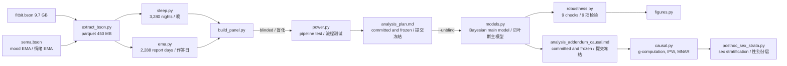
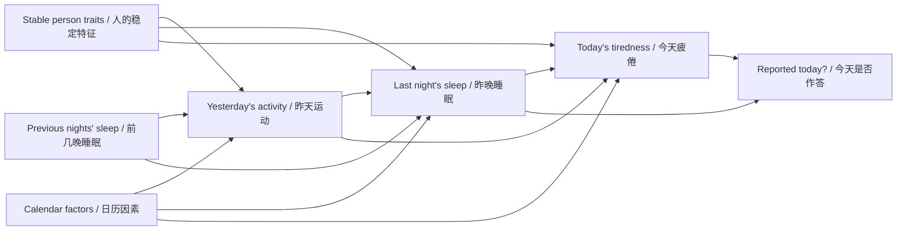

# Supplement / 补充材料

[README](README.md) | [README_CN](README_CN.md)

This file holds the reproduction steps and method details; results and discussion are in the README. Each section is given in English first, then in Chinese.

这里放复现和方法细节，结果和讨论都在 README 里。每一节先英文，后中文。

## Quick Start / 快速开始

```bash
conda env create -f environment.yml
conda activate wearable

# 1. Download LifeSnaps from Zenodo 7229547 into data/raw/, then parse the BSON
#    从 Zenodo 7229547 下载 LifeSnaps，解压到 data/raw/，再解析 BSON
python src/extract_bson.py data/raw/rais_anonymized/mongo_rais_anonymized data/interim/bson

# 2. Blinded run: build a panel with permuted outcomes only
#    盲化流程：只生成打乱结局的面板
python src/build_panel.py
python src/models.py data/interim/panel_blind.parquet reports/blind
python src/power.py data/interim/panel_blind.parquet reports/power.csv

# 3. Pre-specified analysis after unblinding
#    揭盲后的预设分析
python src/build_panel.py --unblind
python src/models.py data/interim/panel.parquet reports/main
python src/robustness.py data/interim/panel.parquet reports/robustness.csv
python src/figures.py

# 4. Causal analysis and the ledger table
#    因果分析和收支账
python src/causal.py reports/causal
python src/posthoc_ledger.py data/interim/panel.parquet reports/causal/ledger.csv
python src/posthoc_sex_strata.py data/interim/panel.parquet reports/causal/sex_strata.csv

# 5. Other post hoc and exploratory analyses
#    其他事后和探索性分析
python src/posthoc_temperature.py data/interim/panel.parquet reports/posthoc_temperature.csv
python src/posthoc_good_nights.py data/interim/panel.parquet reports/posthoc_good_nights
python src/posthoc_early_waking.py reports/posthoc_early_waking
```

The project has no unit tests. Checks come from the blinded run, convergence diagnostics (R-hat, ESS), negative controls and the result files each script writes to `reports/`.

本项目没有单元测试。分析的检查靠盲化流程、收敛诊断（R-hat、ESS）、负对照和各脚本写入 `reports/` 的结果文件。

## Project structure / 项目结构



## Materials and methods / 材料与方法

### Tech stack / 技术栈

Python 3.13 · Bambi 0.21 · PyMC 6.3 · ArviZ 1.3 · statsmodels 0.15 · pandas · pymongo (`bson`) · pyarrow. There are no configuration options or environment variables; the random seed is fixed at 20261029.

Python 3.13 · Bambi 0.21 · PyMC 6.3 · ArviZ 1.3 · statsmodels 0.15 · pandas · pymongo（`bson`）· pyarrow。没有配置项或环境变量，随机种子固定为 20261029。

### Inputs / 输入

| Source / 来源 | Content / 内容 | Use / 用途 |
|---|---|---|
| `fitbit.bson`, sleep type<br>`fitbit.bson`，sleep 类型 | `startTime`, `endTime`, `minutesAsleep`, `efficiency`, `mainSleep` per night<br>每晚的 `startTime`、`endTime`、`minutesAsleep`、`efficiency`、`mainSleep` | Exposures<br>暴露变量 |
| `sema.bson`, Context and Mood Survey | Up to 3 single-choice moods per day (7 classes) and completion time<br>每天最多 3 次的单选情绪（7 类）和完成时间 | Outcome<br>结局变量 |
| `daily_fitbit_sema_df_unprocessed.csv` | Age band, sex, BMI band, steps, vigorous-activity minutes<br>年龄段、性别、BMI 段、步数、高强度活动分钟数 | Covariates, training load<br>协变量、训练负荷 |

EMA (Ecological Momentary Assessment) is a short questionnaire pushed in real time during daily life; here it is the mood check-in.

The official daily CSV **has no sleep onset or wake time**, so the raw BSON has to be parsed. `bson.decode_file_iter` (bundled with `pymongo`) streams it with a small memory footprint and without installing MongoDB: 9.7 GB of BSON becomes a 450 MB parquet. The dataset is advertised as "71 people × 4 months"; only 1,587 days from 53 people have both the previous night's sleep and a mood report.

EMA（Ecological Momentary Assessment，生态瞬时评估）指在日常生活中实时推送的简短问卷，这里就是情绪打卡。

官方提供的日级 CSV **没有入睡和起床时间**，所以必须解析原始 BSON。这里用 `pymongo` 自带的 `bson.decode_file_iter` 流式读取，内存占用很小，也不需要安装 MongoDB：9.7 GB 的 BSON 压缩成 450 MB 的 parquet。数据集标称"71 人 × 4 个月"，实际同时有前一晚睡眠和情绪作答的只有 1,587 天、53 人。

### Cleaning / 清洗流程

| Step / 步骤 | Rows / 行数 |
|---|---|
| Raw sleep records<br>原始 sleep 记录 | 4,141 |
| Main sleep only, deduplicated by `logId`<br>只保留主睡眠，按 `logId` 去重 | 3,415 |
| One record per person-night (the longest); 3–14 h actually asleep; midpoint no later than 12:00 on the wake-up day<br>每人每晚只留一条（取最长的）；实际睡眠 3–14 小时；中点不晚于起床当天 12:00 | 3,280 |
| Completed mood reports with a valid option<br>完成且选项有效的情绪作答 | 5,027 reports, 63 people<br>5,027 条，63 人 |
| Matched to the previous night, with at least 4 of the 7 nights in the window<br>和前一晚睡眠匹配，且 7 晚窗口里至少有 4 晚数据 | **1,587 days, 53 people**<br>**1,587 天，53 人** |

### Pre-specified analysis: schedule deviation and tiredness / 预设分析：作息偏离和疲倦

**Variables / 变量**

- **Outcome.** Whether the first report of the day is TIRED. Only the first is used because it is closest to the previous night's sleep.
- **Main exposure.** `log(1 + |previous night's sleep midpoint − mean midpoint of the other nights in the window|)`, in minutes. The log is used because the raw values are heavily right-skewed (median 34 minutes, maximum 544).
- **Controls.** Signed sleep-duration deviation, weekend, and study week.
- Every exposure is split into a person mean (`_b`) and a within-person deviation (`_w`), each standardized, so all coefficients are effects "per 1 SD".

- **结局**：当天第一次作答是否为 TIRED（疲倦）。只取第一次，是因为它离前一晚的睡眠最近。
- **主暴露**：`log(1 + |前一晚睡眠中点 − 窗口内其他晚的平均中点|)`，单位是分钟。取对数是因为原始值严重右偏（中位数 34 分钟，最大 544 分钟）。
- **控制变量**：睡眠时长偏离（带符号）、是否周末、研究第几周。
- 每个暴露都拆成个人均值（`_b`）和个人内部偏离（`_w`），各自标准化，所以系数都是"每增加 1 个标准差"的效应。

**Model / 模型**

```
tired ~ mid_dev_w + mid_dev_b + dur_dev_w + dur_dev_b + weekend + study_week_z
        + (1 + mid_dev_w | uid)            Bernoulli, logit link / Bernoulli，logit 链接
```

- **Bayesian (primary).** Default weakly informative priors, 4 chains × 1,000 draws, `target_accept=0.95`. R-hat ≤ 1.003 and bulk ESS ≥ 1,354 for all parameters.
- **GEE (cross-check).** Logistic regression with an exchangeable correlation structure and the same fixed effects as the main model.
- **Why not an lme4-style frequentist GLMM.** With 53 people, the random-slope variance is often estimated on the boundary (singular fit).
- **Why not machine-learning prediction metrics.** The question is how large the within-person effect is, not how well tiredness can be predicted. An AUC from a random split by day is inflated because the same person appears in both the training and test sets.

- **贝叶斯（主分析）**：默认的弱信息先验，4 条链 × 1,000 次抽样，`target_accept=0.95`。所有参数的 R-hat ≤ 1.003，bulk ESS ≥ 1,354。
- **GEE（对照）**：可交换相关结构的 logistic 回归，固定效应和主模型相同。
- **为什么不用 lme4 风格的频率学派 GLMM**：53 个人估随机斜率时，方差经常会被估到边界上（奇异拟合）。
- **为什么不用机器学习的预测指标**：这里要回答的是个人内部的效应有多大，不是预测准不准。按天随机划分的 AUC 会因为同一个人的数据同时出现在训练集和测试集里而虚高。

**Blinding.** By default `build_panel.py` permutes each person's outcomes within that person: each person's tiredness base rate is unchanged, but the link to sleep is cut. On the blinded data the main effect is OR 1.00 (0.85–1.18), which shows the blinding works. The limitation is that between-person effects survive the permutation, so they were seen before the plan was frozen; this is recorded in section 7 of `analysis_plan.md`.

**盲化**：`build_panel.py` 默认把每个人的结局在本人内部随机打乱，这样每个人的疲倦基础比例不变，但和睡眠之间的对应关系被切断。在盲化数据上，主效应的估计值为 OR 1.00（0.85–1.18），说明盲化有效。局限是个人之间的效应在打乱后仍然存在，所以在冻结计划之前已经看到过它，这一点记录在 `analysis_plan.md` 第 7 节。

**Power.** Keeping the real number of people, days and exposure values, only the outcome is simulated (person-intercept SD 1.0, slope SD 0.3), 200 simulations per OR. 80% power corresponds to about OR 1.35, so a null result means "no effect larger than 1.35", not "no effect".

**功效**：保持真实的人数、天数和暴露值，只模拟结局（个人截距标准差 1.0，斜率标准差 0.3），每个 OR 模拟 200 次。80% 功效约对应 OR 1.35，所以否定结果的含义是"没有大于 1.35 的效应"，不是"没有效应"。

| OR per 1 SD / 每 1 个标准差的 OR | 1.1 | 1.2 | 1.3 | 1.5 |
|---|---|---|---|---|
| Power / 功效 | 0.15 | 0.48 | 0.73 | 0.99 |

### Causal analysis: absolute effects of income and spending / 因果分析：收入和支出的绝对效应

This part is post hoc. The plan is in [analysis_addendum_causal.md](analysis_addendum_causal.md) and was committed and frozen before any estimation (`e15e766`); it also lists the results already seen before the plan was written.

这部分是事后分析。计划写在 [analysis_addendum_causal.md](analysis_addendum_causal.md)，在任何估计之前提交冻结（`e15e766`），其中也列出了写计划前已经看过的结果。

**Temporal order fixes the adjustment set.** Yesterday's activity comes before last night's sleep: when estimating the effect of sleep, activity is a confounder to control; when estimating the effect of activity, sleep is a mediator that must not be controlled.

**时间顺序决定调整集。** 昨天的运动发生在昨晚睡眠之前：估计睡眠的效应时，运动是要控制的混杂因素；估计运动的效应时，睡眠是不能控制的中介。



**Estimand.** A modified treatment policy: instead of setting everyone to one fixed value, each day's actual exposure is shifted by a fixed amount while the person's mean is kept. The main quantity is the risk difference RD = E[Y(shifted)] − E[Y(actual)], in percentage points.

**估计量。** 用修改处理策略（modified treatment policy）：不是把所有人设成同一个固定值，而是把每一天的实际暴露平移一个量，并保持个人均值不变。主要量是风险差（RD）= E[Y(平移)] − E[Y(实际)]，单位是百分点。

| | E1: income / 收入 | E2: spending / 支出 |
|---|---|---|
| Intervention / 干预 | Actual sleep on one night −1 hour<br>单晚实际睡眠 −1 小时 | Vigorous activity the previous day +30 minutes<br>前一天高强度运动 +30 分钟 |
| Adjusted for / 调整 | Yesterday's activity (within and between person), yesterday's steps, sleep on the previous 3 nights, weekend, Monday effect, study week<br>昨天运动（人内、人间）、昨天步数、前 3 晚睡眠、周末、周一效应、研究周 | Sleep on the previous 3 nights, weekend, Monday effect, study week<br>前 3 晚睡眠、周末、周一效应、研究周 |
| Not adjusted for / 不调整 | | Last night's sleep (mediator)<br>昨晚睡眠（中介） |
| Days whose shifted value stays within the person's observed range / 平移后仍在本人观测范围内的天数 | 90% | 80% |

**Methods / 方法**

| Problem / 问题 | Approach / 做法 | Why / 为什么这样选 |
|---|---|---|
| Individual differences<br>个体差异 | Hierarchical logistic regression with random intercepts and random slopes for the exposure; within/between decomposition<br>分层 logistic 回归，随机截距加暴露的随机斜率；人内/人间分解 | Removes time-invariant confounding and lets each person have their own sensitivity<br>去掉不随时间变化的混杂，并允许每个人的敏感度不同 |
| Absolute effect<br>绝对效应 | g-computation: for each posterior draw, predict the actual and shifted scenarios with each person's own random effects, average, and subtract<br>g-computation：对每个后验抽样，用每个人自己的随机效应预测实际和平移两种情况，取平均后相减 | An OR does not say how much the tiredness probability changes; a fixed intervention would extrapolate to values some people never reach<br>OR 不能直接回答"疲倦概率变化多少"；固定干预会外推到某些人从未出现过的取值 |
| Time-varying confounding<br>时变混杂 | A single-time-point adjustment set fixed by temporal order<br>按时间顺序确定的单时点调整集 | 53 people and 233 tired days cannot support a longitudinal g-formula for multi-day interventions<br>53 人、233 个疲倦日支撑不了持续多天干预的纵向 g-formula |
| Missingness (MAR)<br>缺失（MAR） | Two-step IPW: probability of having sleep data, then of reporting given sleep data; stabilized weights truncated at the 1st and 99th percentiles<br>两步 IPW：有睡眠的概率，以及有睡眠时作答的概率；稳定化权重，截断在 1% 和 99% 分位 | The second step can use that night's exposure, adding a layer of correction over analysing complete cases only<br>第二步能用上当晚的暴露，比只分析完整数据多一层校正 |
| Missingness (MNAR)<br>缺失（MNAR） | Tipping-point analysis: fractionally impute days with sleep but no report, add δ on the logit scale, and apply it only to the half of days unfavourable to the conclusion<br>临界点分析：对"有睡眠、没作答"的日子分数填补，在 logit 尺度加 δ，只加在对结论不利的一半日子上 | Answers how strong the "people who feel tired do not check in" assumption must be to overturn the conclusion<br>回答"累的时候不打卡"的假设要多强才能推翻结论 |
| Unmeasured confounding<br>未测混杂 | Negative-exposure controls (next night, next day) and E-values<br>负暴露对照（下一晚、第二天）和 E-value | Negative controls can reveal some confounding; the E-value quantifies how easily the conclusion could be overturned<br>负对照能发现部分混杂，E-value 量化结论有多容易被推翻 |

The non-Bayesian parts use a person-clustered bootstrap (1,000 resamples; 500 for the MNAR analysis), re-estimating the weights and the model each time. The frame is 2,794 calendar person-days from 53 people between each person's first and last report; 1,904 days have usable sleep data and 1,587 days (56.8%) also have a report, so about 43% of person-days are missing.

非贝叶斯部分用按人聚类的 bootstrap（1,000 次，MNAR 500 次），每次都重新估计权重和模型。分析框架是 53 人、从第一次到最后一次作答之间的 2,794 个日历人日，其中 1,904 天有可用睡眠，1,587 天（56.8%）同时有作答，所以约 43% 的人日缺失。

**Frozen decision rule.** The result is described as "supports a causal interpretation under the stated assumptions" only if all three hold: the 95% interval of the Bayesian RD excludes 0 in the expected direction; the IPW RD has the same sign; and the 95% interval of the negative control includes 0.

**冻结的判读规则。** 同时满足以下 3 条，才写"在所述假设下支持因果解释"：贝叶斯 RD 的 95% 区间不含 0 且方向符合预期；IPW 的 RD 同向；负对照的 95% 区间包含 0。

### Levels of evidence / 证据等级

Results are labelled **pre-specified** (frozen before unblinding), **post hoc** (with a written specification) or **exploratory** (not specified in advance, hypothesis-generating only).

结果标注了证据等级：**预设**（揭盲前冻结）、**事后**（有书面规格）、**探索**（没有事先规定，只能提出假设）。
