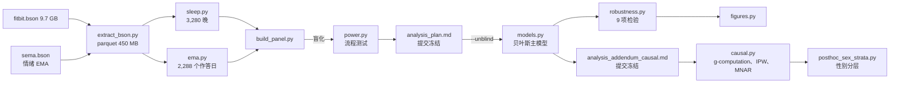
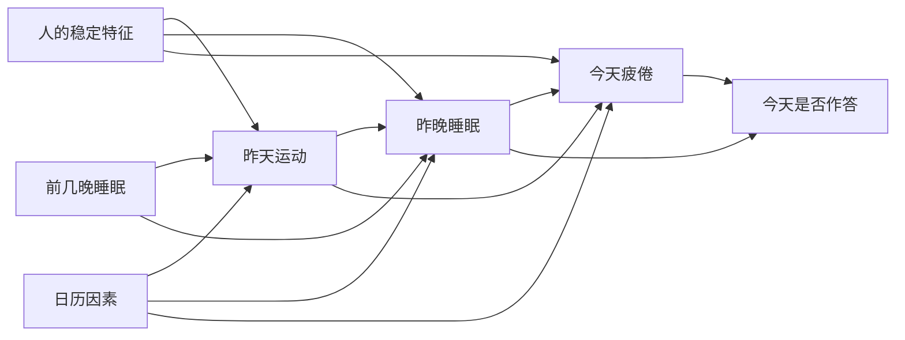

# 补充材料

[返回 README](README_CN.md)

这里放复现和方法细节。结果和讨论都在 README 里。

## Quick Start

```bash
conda env create -f environment.yml
conda activate wearable

# 1. 从 Zenodo 7229547 下载 LifeSnaps，解压到 data/raw/，再解析 BSON
python src/extract_bson.py data/raw/rais_anonymized/mongo_rais_anonymized data/interim/bson

# 2. 盲化流程：只生成打乱结局的面板
python src/build_panel.py
python src/models.py data/interim/panel_blind.parquet reports/blind
python src/power.py data/interim/panel_blind.parquet reports/power.csv

# 3. 揭盲后的预设分析
python src/build_panel.py --unblind
python src/models.py data/interim/panel.parquet reports/main
python src/robustness.py data/interim/panel.parquet reports/robustness.csv
python src/figures.py

# 4. 因果分析和收支账
python src/causal.py reports/causal
python src/posthoc_ledger.py data/interim/panel.parquet reports/causal/ledger.csv
python src/posthoc_sex_strata.py data/interim/panel.parquet reports/causal/sex_strata.csv

# 5. 其他事后和探索性分析
python src/posthoc_temperature.py data/interim/panel.parquet reports/posthoc_temperature.csv
python src/posthoc_good_nights.py data/interim/panel.parquet reports/posthoc_good_nights
python src/posthoc_early_waking.py reports/posthoc_early_waking
```

本项目没有单元测试。分析的检查靠盲化流程、收敛诊断（R-hat、ESS）、负对照和各脚本写入 `reports/` 的结果文件。

## 项目结构



## Materials and Methods

### 技术栈

Python 3.13 · Bambi 0.21 · PyMC 6.3 · ArviZ 1.3 · statsmodels 0.15 · pandas · pymongo（`bson`）· pyarrow。没有配置项或环境变量，随机种子固定为 20261029。

### 输入

| 来源 | 内容 | 用途 |
|---|---|---|
| `fitbit.bson`，sleep 类型 | 每晚的 `startTime`、`endTime`、`minutesAsleep`、`efficiency`、`mainSleep` | 暴露变量 |
| `sema.bson`，Context and Mood Survey | 每天最多 3 次的单选情绪（7 类）和完成时间 | 结局变量 |
| `daily_fitbit_sema_df_unprocessed.csv` | 年龄段、性别、BMI 段、步数、高强度活动分钟数 | 协变量、训练负荷 |

EMA（Ecological Momentary Assessment，生态瞬时评估）指在日常生活中实时推送的简短问卷，这里就是情绪打卡。

官方提供的日级 CSV **没有入睡和起床时间**，所以必须解析原始 BSON。这里用 `pymongo` 自带的 `bson.decode_file_iter` 流式读取，内存占用很小，也不需要安装 MongoDB：9.7 GB 的 BSON 压缩成 450 MB 的 parquet。数据集标称"71 人 × 4 个月"，实际同时有前一晚睡眠和情绪作答的只有 1,587 天、53 人。

### 清洗流程

| 步骤 | 行数 |
|---|---|
| 原始 sleep 记录 | 4,141 |
| 只保留主睡眠，按 `logId` 去重 | 3,415 |
| 每人每晚只留一条（取最长的）；实际睡眠 3–14 小时；中点不晚于起床当天 12:00 | 3,280 |
| 完成且选项有效的情绪作答 | 5,027 条，63 人 |
| 和前一晚睡眠匹配，且 7 晚窗口里至少有 4 晚数据 | **1,587 天，53 人** |

### 预设分析：作息偏离和疲倦

**变量**

- **结局**：当天第一次作答是否为 TIRED（疲倦）。只取第一次，是因为它离前一晚的睡眠最近。
- **主暴露**：`log(1 + |前一晚睡眠中点 − 窗口内其他晚的平均中点|)`，单位是分钟。取对数是因为原始值严重右偏（中位数 34 分钟，最大 544 分钟）。
- **控制变量**：睡眠时长偏离（带符号）、是否周末、研究第几周。
- 每个暴露都拆成个人均值（`_b`）和个人内部偏离（`_w`），各自标准化，所以系数都是"每增加 1 个标准差"的效应。

**模型**

```
tired ~ mid_dev_w + mid_dev_b + dur_dev_w + dur_dev_b + weekend + study_week_z
        + (1 + mid_dev_w | uid)            Bernoulli，logit 链接
```

- **贝叶斯（主分析）**：默认的弱信息先验，4 条链 × 1,000 次抽样，`target_accept=0.95`。所有参数的 R-hat ≤ 1.003，bulk ESS ≥ 1,354。
- **GEE（对照）**：可交换相关结构的 logistic 回归，固定效应和主模型相同。
- **为什么不用 lme4 风格的频率学派 GLMM**：53 个人估随机斜率时，方差经常会被估到边界上（奇异拟合）。
- **为什么不用机器学习的预测指标**：这里要回答的是个人内部的效应有多大，不是预测准不准。按天随机划分的 AUC 会因为同一个人的数据同时出现在训练集和测试集里而虚高。

**盲化**：`build_panel.py` 默认把每个人的结局在本人内部随机打乱，这样每个人的疲倦基础比例不变，但和睡眠之间的对应关系被切断。在盲化数据上，主效应的估计值为 OR 1.00（0.85–1.18），说明盲化有效。局限是个人之间的效应在打乱后仍然存在，所以在冻结计划之前已经看到过它，这一点记录在 `analysis_plan.md` 第 7 节。

**功效**：保持真实的人数、天数和暴露值，只模拟结局（个人截距标准差 1.0，斜率标准差 0.3），每个 OR 模拟 200 次。80% 功效约对应 OR 1.35，所以否定结果的含义是"没有大于 1.35 的效应"，不是"没有效应"。

| 每 1 个标准差的 OR | 1.1 | 1.2 | 1.3 | 1.5 |
|---|---|---|---|---|
| 功效 | 0.15 | 0.48 | 0.73 | 0.99 |

### 因果分析：收入和支出的绝对效应

这部分是事后分析。计划写在 [analysis_addendum_causal.md](analysis_addendum_causal.md)，在任何估计之前提交冻结（`e15e766`），其中也列出了写计划前已经看过的结果。

**时间顺序决定调整集。** 昨天的运动发生在昨晚睡眠之前：估计睡眠的效应时，运动是要控制的混杂因素；估计运动的效应时，睡眠是不能控制的中介。



**估计量。** 用修改处理策略（modified treatment policy）：不是把所有人设成同一个固定值，而是把每一天的实际暴露平移一个量，并保持个人均值不变。主要量是风险差（RD）= E[Y(平移)] − E[Y(实际)]，单位是百分点。

| | E1：收入 | E2：支出 |
|---|---|---|
| 干预 | 单晚实际睡眠 −1 小时 | 前一天高强度运动 +30 分钟 |
| 调整 | 昨天运动（人内、人间）、昨天步数、前 3 晚睡眠、周末、周一效应、研究周 | 前 3 晚睡眠、周末、周一效应、研究周 |
| 不调整 | | 昨晚睡眠（中介） |
| 平移后仍在本人观测范围内的天数 | 90% | 80% |

**方法。**

| 问题 | 做法 | 为什么这样选 |
|---|---|---|
| 个体差异 | 分层 logistic 回归，随机截距加暴露的随机斜率；人内/人间分解 | 去掉不随时间变化的混杂，并允许每个人的敏感度不同 |
| 绝对效应 | g-computation：对每个后验抽样，用每个人自己的随机效应预测实际和平移两种情况，取平均后相减 | OR 不能直接回答"疲倦概率变化多少"；固定干预会外推到某些人从未出现过的取值 |
| 时变混杂 | 按时间顺序确定的单时点调整集 | 53 人、233 个疲倦日支撑不了持续多天干预的纵向 g-formula |
| 缺失（MAR） | 两步 IPW：有睡眠的概率，以及有睡眠时作答的概率；稳定化权重，截断在 1% 和 99% 分位 | 第二步能用上当晚的暴露，比只分析完整数据多一层校正 |
| 缺失（MNAR） | 临界点分析：对"有睡眠、没作答"的日子分数填补，在 logit 尺度加 δ，只加在对结论不利的一半日子上 | 回答"累的时候不打卡"的假设要多强才能推翻结论 |
| 未测混杂 | 负暴露对照（下一晚、第二天）和 E-value | 负对照能发现部分混杂，E-value 量化结论有多容易被推翻 |

非贝叶斯部分用按人聚类的 bootstrap（1,000 次，MNAR 500 次），每次都重新估计权重和模型。分析框架是 53 人、从第一次到最后一次作答之间的 2,794 个日历人日，其中 1,904 天有可用睡眠，1,587 天（56.8%）同时有作答，所以约 43% 的人日缺失。

**冻结的判读规则。** 同时满足以下 3 条，才写"在所述假设下支持因果解释"：贝叶斯 RD 的 95% 区间不含 0 且方向符合预期；IPW 的 RD 同向；负对照的 95% 区间包含 0。

### 证据等级

下文都标注了证据等级：**预设**（揭盲前冻结）、**事后**（有书面规格）、**探索**（没有事先规定，只能提出假设）。
