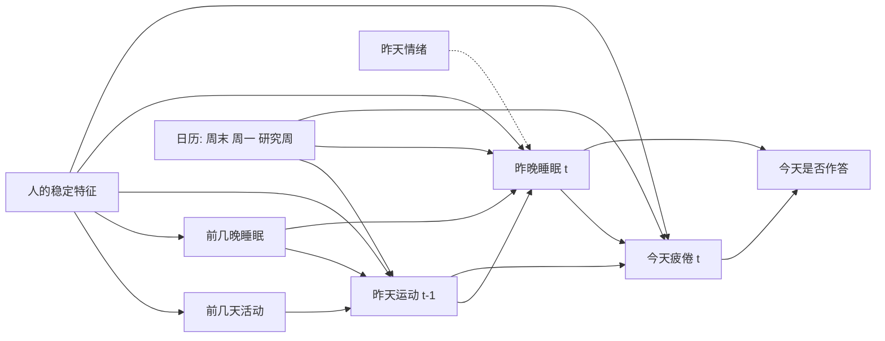

# 补充分析：睡眠不足和训练负荷对次日疲倦的因果效应（事后分析）

**性质：事后分析。** LifeSnaps 的结局已在 commit `4f44e67` 之后揭盲，所以这里的结果不是确认性结论。确认要在 PMData 上另写计划。本文件写于跑下面任何一项估计之前，提交时间就是冻结时间。

**写计划之前已经看过的结果：**

- 主模型里的睡眠时长偏离 OR 0.73，事后负对照 0.71 对 1.06。
- 前一天高强度运动 OR：好睡眠夜晚 1.76，全部夜晚 1.22。
- "少睡 × 多练"的未校正 2×2 疲倦比例：9.6%、13.3%、16.6%、21.5%。
- 一次粗略检查：加入昨天疲倦后，时长 OR 0.724 → 0.721，运动 OR 1.253 → 1.250；昨天疲倦几乎不预测昨晚时长（0.04 SD，p = 0.63）。

这些结果影响了问题的选择，所以效应方向不能算独立证据。下面的调整集按时间顺序和 DAG 决定，不按这些结果挑选。

## 问题

1. 如果**某一晚**比实际少睡 1 小时，第二天第一次作答报告疲倦的概率会变化多少？
2. 如果**前一天**的高强度运动比实际多 30 分钟，这个概率会变化多少？

## 时间顺序和 DAG



- 人的稳定特征：用人内和人间分解加随机截距处理。
- 昨天运动是"昨晚睡眠 → 今天疲倦"的混杂因素。
- 昨晚睡眠是"昨天运动 → 今天疲倦"的中介，所以 E2 的总效应**不能**控制它。
- 虚线表示昨天情绪只在作答的日子可见，放在敏感性分析里。

## 估计量

用修改处理策略（modified treatment policy）：不是把所有人设成同一个固定值，而是把每一天的实际暴露平移一个量。这样落在每个人自己的分布里，正值性（positivity）问题比固定干预小。

- 目标人群：分析集所用的 53 人的人日分布。
- **E1**：每一晚 `dur_dev_h` 减 1 小时。个人均值不变，含义是"只这一晚少睡"。
- **E2**：前一天 `very_active_minutes` 加 30 分钟，个人均值不变。
- **主要量**：风险差 RD = E[Y(平移)] − E[Y(实际)]，单位是百分点。另报告 RR。
- 这是单时点干预。不做持续多天干预的纵向 g-formula：53 人、233 个疲倦日支撑不了。

## 调整集

| 变量 | 定义 | E1 | E2 |
|---|---|---|---|
| `dur_dev` 人内/人间 | 昨晚时长相对前 6 晚的偏离 | 暴露 | 中介，不控制 |
| `active_prev` 人内/人间 | 昨天高强度运动分钟数 | 控制 | 暴露 |
| `steps_prev` 人内 | 昨天步数 | 控制 | 不控制（与暴露同日，可能在路径上） |
| `sleep_lag3` 人内 | 昨晚之前 3 晚 `dur_dev_h` 的均值，至少 1 晚 | 控制 | 控制 |
| `weekend`、`prev_weekend` | 今天、昨天是否周末（`prev_weekend` 用来捕捉周一） | 控制 | 控制 |
| `study_week_z` | 研究周 | 控制 | 控制 |

任一调整变量缺失的人日从主分析中剔除，并报告数量。

## 主分析

贝叶斯分层 logistic 回归，设定和主模型相同（Bambi，4 条链 × 1,000 次抽样，`target_accept=0.95`）。随机截距加暴露的随机斜率：

```
E1: tired ~ dur_w + dur_b + active_w + active_b + steps_w + lag3_w
          + weekend + prev_weekend + study_week_z + (1 + dur_w | uid)
E2: tired ~ active_w + active_b + lag3_w
          + weekend + prev_weekend + study_week_z + (1 + active_w | uid)
```

g-computation：对每一个后验抽样，用**每个人自己的**随机效应预测所有人日在实际和平移两种情况下的疲倦概率，取平均后相减，得到 RD 的后验分布。收敛要求和主模型相同：R-hat ≤ 1.01，bulk ESS ≥ 400。

## 缺失数据

**分析框架**：53 人，每人从第一次到最后一次情绪作答之间的每个日历日。

**IPW（在可观测信息下随机缺失，MAR）**：分两步。
1. 有可用睡眠的概率：周末、`prev_weekend`、研究周、昨天是否在分析集、过去 7 天在分析集的比例、个人在分析集的比例。
2. 有睡眠的日子里作答的概率：在第 1 步的变量上加 `dur_dev_h`、昨天 `very_active_minutes`（缺失时用个人均值填补并加缺失指示）。

稳定化权重 = 个人总体比例 / (p₁ × p₂)，在 1% 和 99% 分位截断。结局模型用加权 logistic（人内/人间分解，不含随机效应），再做 g-computation。

**MNAR 临界点**：只有"有睡眠、没作答"的日子有暴露，可以填补；用结局模型预测疲倦概率，在 logit 尺度加 δ，再用分数填补重新估计。δ **只加在对结论不利的那一半日子上**（E1：`dur_dev_h` ≥ 0；E2：运动不高于本人均值），即假设暴露较好的日子不作答时更累。δ ∈ {0, 0.5, 1, 1.5, 2, 3}，报告 95% 区间开始包含 0 的最小 δ。

非贝叶斯部分的区间都用按人聚类的 bootstrap（1,000 次，MNAR 500 次，种子 20261029），每次 bootstrap 都重新估计权重和模型。

## 未测混杂

- **E-value**：用 RR 计算点估计和区间靠近 1 一端的 E-value。
- **负暴露对照**：E1 用**下一晚**的时长平移 −1 小时；E2 用**第二天**的运动量平移 +30 分钟，都放进对应的主模型结构里，用 bootstrap 估计 RD。今天的疲倦可能影响之后的睡眠和运动，所以负对照不为 0 时可能是反向因果，不一定是混杂。

## 敏感性分析

用加权前的 logistic 加 bootstrap，和 IPW 结果放在同一口径下比较：

1. 基线：不加权。
2. 加入昨天疲倦（只有连续作答的日子）。
3. 只看 13:00 之前第一次作答的日子。
4. 暴露加二次项。
5. E2 的运动量改用 `log1p`，平移仍是原始尺度 +30 分钟。
6. E1 加入睡眠中点偏离。
7. E2 的受控直接效应：控制昨晚时长，保持昨晚睡眠不变。

## 判读规则

E1、E2 分别判断。满足以下全部，才写"在所述假设下支持因果解释"：

1. 贝叶斯 RD 的 95% 可信区间不含 0，方向符合预期（E1、E2 都 > 0）。
2. IPW 的 RD 同向。
3. 负对照的 95% 区间包含 0。

只满足一部分时写"关联，未通过因果检验"，并写明没通过哪一项。MNAR 临界点和 E-value 只报告，不设阈值。两个估计量不做多重比较校正，全部标为事后分析。

## 这份分析回答不了什么

- 可交换性（给定调整集后无未测混杂）无法验证，工作压力、饮酒、生病都没有测量。
- `very_active_minutes` 不等于训练负荷，也分不清运动类型。
- 结局是 7 选 1 单选，不是疲倦程度。
- 平移只代表单晚或单日的改变，不能外推到长期改变作息。
